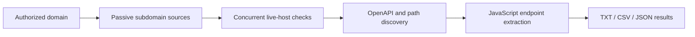

# SCAN - VA CLI Toolkit

[](https://github.com/NorShadeed/scan-va-toolkit/actions/workflows/tests.yml)


CLI and Windows desktop app for **subdomain enumeration**, **API endpoint
discovery**, and same-origin crawling. No database or server required.



The toolkit combines source coverage reporting, bounded concurrency, strict same-origin crawling, endpoint prioritization, cancellable desktop scans, and portable result exports. It is designed for owned targets and authorized security assessments.

Requires Python 3.10 or newer.

---

## Structure

```
scan-cli/
├── scan.py              ← main CLI entry point
├── desktop.py           ← Windows desktop application
├── scan-desktop.bat     ← double-click Windows launcher
├── lib/
│   ├── subfinder.py     ← subdomain discovery engine
│   ├── api_discovery.py ← API endpoint discovery engine
│   └── crawler.py       ← same-origin web crawler
├── requirements.txt
├── install.sh
└── README.md
```

---

## Install on Linux / VPS

```bash
# Transfer to your VPS first, then:
chmod +x install.sh
./install.sh

# Add to PATH if prompted:
echo 'export PATH="$HOME/.local/bin:$PATH"' >> ~/.bashrc && source ~/.bashrc
```

## Windows desktop application

The desktop interface uses the built-in Windows GUI toolkit, so it does not
need an additional UI package. Set up the project once from PowerShell:

```powershell
cd C:\path\to\scan-cli
py -3.10 -m venv .venv
.\.venv\Scripts\python.exe -m pip install -r requirements.txt
```

Then double-click `scan-desktop.bat`, or launch it directly:

```powershell
.\.venv\Scripts\pythonw.exe desktop.py
```

For substantially broader subdomain coverage, install the optional official
ProjectDiscovery Subfinder engine. The included installer downloads the latest
Windows AMD64 release from ProjectDiscovery and verifies its published SHA-256
checksum before placing it in this project's `tools` folder:

```powershell
powershell -ExecutionPolicy Bypass -File .\install-subfinder.ps1
```

The app keeps scans in a background process so the interface remains
responsive. It provides cancellation, live activity, searchable result tables,
automatic JSON exports, and bounded worker controls.

## Run without installing (portable mode)

```bash
pip3 install -r requirements.txt
python3 scan.py --help
```

---

## Commands

### Subdomain enumeration

```bash
scan subs -d example.com
scan subs -d example.com -o subs.txt
scan subs -d example.com -o subs.json --format json
scan subs -d example.com --live-only
scan subs -d example.com --live-only --workers 150
```

### API endpoint discovery

```bash
scan endpoints -u https://api.example.com
scan endpoints -u https://api.example.com -o results.json --format json
scan endpoints -u https://api.example.com --min-priority 60
scan endpoints -u https://api.example.com --methods GET,POST,DELETE
scan endpoints -u https://api.example.com --timeout 15
```

### Full recon (subdomains → then endpoints on each)

```bash
scan full -d example.com
scan full -d example.com --max-hosts 5 -o full.json --format json
scan full -d example.com --min-priority 60 --methods GET,POST
```

---

## Options reference

| Flag | Default | Description |
|---|---|---|
| `-o / --output` | *(none)* | Save results to file |
| `--format` | `txt` / `json` | Output format: `txt`, `json`, `csv` |
| `--timeout` | 10–30s | HTTP request timeout |
| `--source-threads` | `6` | Passive discovery sources to run concurrently (maximum 8) |
| `--subfinder-timeout` | `120` | Maximum runtime for the optional subfinder binary |
| `--all-sources` | — | Use every subfinder provider; slower but may find more results |
| `--live-only` | — | Return only subdomains responding over HTTP or HTTPS |
| `--live-timeout` | `4` | Response timeout for each live-host probe |
| `--live-threads / --workers` | `100` | Concurrent live probes (maximum 200) |
| `--min-priority` | `0` | Only show endpoints scored ≥ N (0–100) |
| `--methods` | *(all)* | Filter by HTTP method, e.g. `GET,POST` |
| `--max-hosts` | `10` | (full only) Max hosts to scan endpoints on |
| `--no-banner` | — | Suppress banner (good for piping) |

### Priority levels

| Score | Label | Meaning |
|---|---|---|
| 80–100 | **HIGH** | Admin, internal, debug, destructive paths |
| 60–79 | **MED** | Auth, versioned APIs, user data |
| 0–59 | **LOW** | Public, health, info endpoints |

---

## Fast subdomain scanning

Subdomain discovery runs all available passive sources concurrently. When
`--live-only` is enabled, HTTP/HTTPS checks use 100 workers by default. Increase
this up to 200 on a reliable network, or lower it when scanning a fragile target:

```bash
# Fast default
scan subs -d example.com --live-only

# More aggressive
scan subs -d example.com --live-only --workers 200 --live-timeout 3

# Gentler scan
scan subs -d example.com --live-only --workers 25
```

Only scan targets you are authorized to test. High worker counts can create a
large burst of connections.

## Subdomain sources

These sources run at the same time and their results are merged and deduplicated:

1. **subfinder binary** — optional extended engine with many providers
2. **crt.sh** — certificate transparency logs
3. **Cert Spotter** — certificate transparency search with bounded pagination
4. **URLScan** — historical public web-scan index
5. **HackerTarget** — passive DNS API (free tier)
6. **AlienVault OTX** — passive DNS when `OTX_API_KEY` is configured

Every run prints a source coverage report with result counts, duration, skipped
providers, rate limits, and request failures. A low total should be interpreted
together with this report; it is not proof that the target has only that many
subdomains. The desktop app shows when the extended Subfinder engine is missing
and can launch the checksum-verified installer.

## Endpoint discovery methods

1. **Swagger/OpenAPI** — parses documented spec if available
2. **Directory fuzzing** — probes 80+ common API paths
3. **Pattern generation** — derives variations from found paths
4. **Response analysis** — extracts URLs from JSON responses
5. **JavaScript parsing** — greps API calls from script files

---

## Optional: install subfinder binary

Significantly improves subdomain discovery:

```bash
# Requires Go
go install github.com/projectdiscovery/subfinder/v2/cmd/subfinder@latest
echo 'export PATH="$HOME/go/bin:$PATH"' >> ~/.bashrc && source ~/.bashrc

# Or download pre-built binary:
# https://github.com/projectdiscovery/subfinder/releases
```

---

## Debug mode

```bash
SCAN_DEBUG=1 scan endpoints -u https://api.example.com
```

---

> ⚠️ **Only scan targets you have explicit written permission to test.**

## Verification

```bash
python -m pytest -q
```

The automated tests cover same-origin link and form extraction, duplicate handling, concurrent passive sources, domain-boundary filtering, provider failures, and bounded live-host checks.
